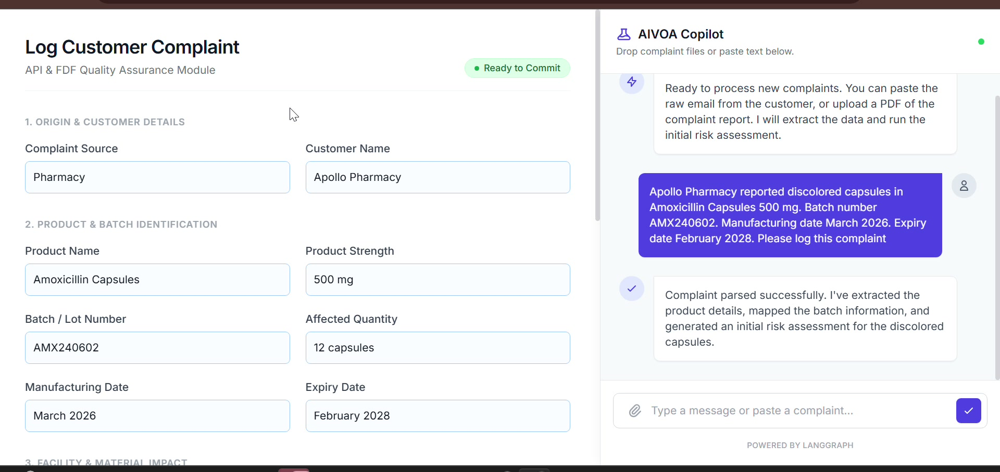
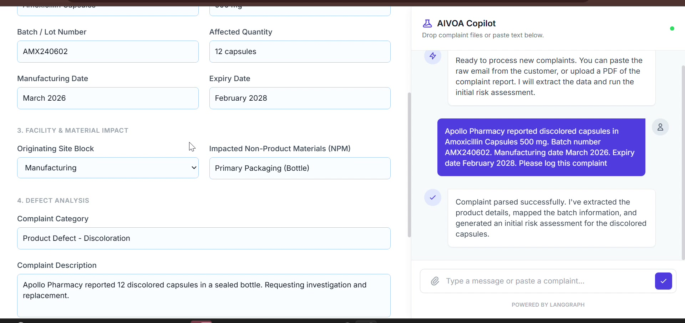
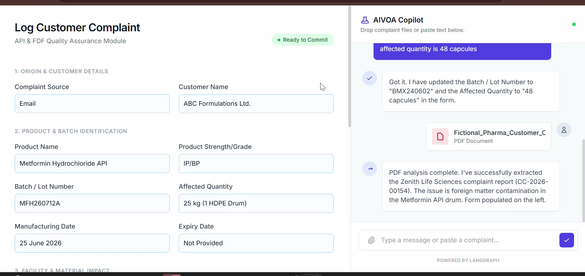
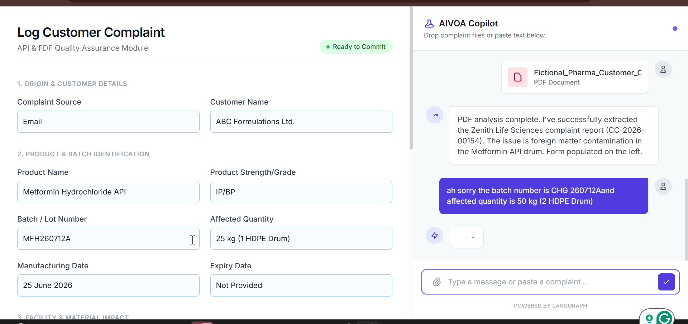

# AIVOA.AI — AI-Powered Root Cause Analysis (RCA) Platform & AIVOA Copilot for Pharmaceutical Quality Operations

[](https://aivoa-rca-platform.vercel.app)
[](https://github.com/AvneeshTripathi72/aivoa-rca-platform)
[](https://drive.google.com/file/d/1av2lzDPx8YMSzTrIz7w51HTRWBz3_5Nj/view)
[](https://www.kiet.edu/)

- 🌐 **Live Deployed Application:** [https://aivoa-rca-platform.vercel.app](https://aivoa-rca-platform.vercel.app)
- 📂 **GitHub Repository:** [https://github.com/AvneeshTripathi72/aivoa-rca-platform](https://github.com/AvneeshTripathi72/aivoa-rca-platform)
- 🎥 **Reference Video Demonstration:** [Google Drive Demo Link](https://drive.google.com/file/d/1av2lzDPx8YMSzTrIz7w51HTRWBz3_5Nj/view)
- 🏛️ **Institutional Affiliation:** [KIET Group of Institutions](https://www.kiet.edu/)
- 👨‍💻 **Developer / Candidate:** [Avneesh Tripathi](https://github.com/AvneeshTripathi72)

> **Regulatory Compliance Context:** Conforming to ICH Q7 (GMP for Active Pharmaceutical Ingredients), ICH Q9 (Quality Risk Management), ICH Q10 (Pharmaceutical Quality Systems), 21 CFR Part 11 / 21 CFR 211, Schedule M, and ALCOA+ Data Integrity Principles.
>
> **Core Product Philosophy:** *AI investigates and recommends. Qualified Quality Professionals review, validate, edit, and approve.* Every AI finding is marked strictly as a hypothesis or evidence-supported candidate. No AI hypothesis is ever presented as a scientifically confirmed fact without formal human validation.

---

## 1. Executive Summary & Video Alignment

This project implements the full-stack, enterprise-grade Root Cause Analysis (RCA) platform for pharmaceutical manufacturing, updated to match the **AIVOA Complaints & Incident Intake Video Demo** (`AIVOA- complaints module demo.mp4`).

The application features a synchronized two-way workflow:
1. **Incident Intake & QMS Triage with AIVOA Copilot:** A split-screen interface featuring the live QMS intake form on the left and the conversational AIVOA Copilot on the right.
2. **Deep Root Cause Analysis Module:** Once committed to the QMS ledger, the incident transitions into the comprehensive RCA hub featuring the LangGraph 10-node engine, 5 Whys Analysis, 6M Ishikawa Fishbone, Evidence Registry, CAPA Matrix, and ALCOA+ Sign-Off.

---

## 2. AIVOA Copilot: Split-Screen Triage Experience (Video Demonstration)

> 🎥 **Reference Video Demonstration:** [Watch Video Demo on Google Drive](https://drive.google.com/file/d/1av2lzDPx8YMSzTrIz7w51HTRWBz3_5Nj/view)
>
> The interface reproduces the synchronized split-screen incident intake experience demonstrated in the reference video:

### Visual Demonstration Walkthrough

| 1. AIVOA Copilot Intake & Live Form Triage | 2. Conversational Field Refinement |
|:---:|:---:|
|  |  |
| *Extracting natural language complaints into the 4 QMS sections* | *Refining batch & quantity while preserving existing fields* |

| 3. PDF Document Extraction & Risk Assessment | 4. Triage Ready to Commit to QMS Ledger |
|:---:|:---:|
|  |  |
| *PyMuPDF extraction of incident report with risk telemetry* | *Status updates to 'Ready to Commit' for official RCA launch* |

The New Investigation Workspace (`/investigations/new`) reproduces the design and functionality demonstrated in the video:

```
┌───────────────────────────────────────────────┬───────────────────────────────────────────────┐
│ LEFT PANEL: Incident Intake & QMS Triage      │ RIGHT PANEL: AIVOA Copilot (Interactive AI)   │
├───────────────────────────────────────────────┼───────────────────────────────────────────────┤
│ Status: [ Ready to Commit / Pending Triage ]  │ [⚗️ AIVOA Copilot]  ● Live                    │
│                                               │ "Drop complaint files or paste text below."   │
│ 1. ORIGIN & CUSTOMER / INCIDENT DETAILS       │                                               │
│    • Complaint Source  • Customer Name        │ [AI Greeting & Quick Demo Scenario Pills]     │
│    • Contact Information                      │                                               │
│                                               │ [User Message: Apollo Pharmacy Complaint]     │
│ 2. PRODUCT & BATCH IDENTIFICATION             │                                               │
│    • Product Name      • Dosage Form          │ [Copilot: "Complaint parsed successfully.     │
│    • Strength/Grade    • Batch / Lot Number   │  Extracted Atorvastatin Calcium 20mg, mapped  │
│    • Affected Quantity • Mfg / Expiry Dates   │  batch ATC-2026-088 into the QMS form..."]    │
│                                               │                                               │
│ 3. FACILITY & MATERIAL IMPACT                 │ [User Message: "ah sorry the batch number is  │
│    • Originating Site & Block                 │  BMX240602 and affected quantity is 48 caps"] │
│    • Impacted NPM      • Equipment ID         │                                               │
│                                               │ [Copilot: "Got it. I have updated the Batch   │
│ 4. DEFECT / EXCURSION ANALYSIS                │  Number to 'BMX240602' and Affected Quantity  │
│    • Defect Category   • Incident Headline    │  to '48 capsules' in the form."]              │
│    • Excursion Description                    │                                               │
│    • Suggested Immediate Containment Action   │ [Paperclip Upload] [Chat Input] [Send Button] │
│                                               │                                               │
│ [AI COPILOT RISK ASSESSMENT CARD]             │ [POWERED BY LANGGRAPH • GROQ LLM • 21 CFR 11] │
│   Severity | Defect Nature | Regulatory Impact│                                               │
├───────────────────────────────────────────────┴───────────────────────────────────────────────┤
│ [COMMIT TO QMS LEDGER & LAUNCH RCA] ──► Transitions to Deep Root Cause Analysis Hub           │
└───────────────────────────────────────────────────────────────────────────────────────────────┘
```

### Visual & Functional Micro-Interactions
- **`Awaiting AI extraction...` Placeholders:** Empty fields show an italicized placeholder with a red ban circle icon (`⊘`). Clicking or focusing any field instantly converts it into a clean editable input.
- **Dynamic Triage Status Badge:** Transitions from `Pending Triage` (amber) to `Ready to Commit` (emerald) as soon as core incident data is extracted.
- **AI Copilot Risk Assessment Card:** Renders below Section 4, presenting the real-time AI risk evaluation: Initial Severity (Critical / Major / Minor), Defect Nature & Vector, Regulatory Framework, and Risk Justification.

### The 3 Demonstrated Copilot Tools
1. **`Log Complaint / Incident Tool` (`log_complaint`):** Parses raw natural language text (e.g., customer complaints from Apollo Pharmacy, temperature spikes in Crystallizer-04) and synchronizes with all form fields and risk metrics.
2. **`Edit Complaint / Refine Tool` (`edit_complaint`):** Enables natural language conversational refinement (e.g. *"ah sorry the batch number is BMX240602 and affected quantity is 48 capsules"*). It updates the targeted fields while strictly preserving all other existing form data.
3. **`Document Extraction Tool` (`document_extraction`):** Accepts PDF reports (e.g., Zenith Life Sciences / Metformin contamination report or plant deviation logs), extracts technical text via PyMuPDF, and auto-populates the form.

---

## 3. Technology Stack

### Frontend
- **Framework:** React.js (v18.3) with Vite
- **State Management:** Redux Toolkit (`investigationSlice`, `aiSlice`, `dashboardSlice`)
- **Styling:** Tailwind CSS (Enterprise Deep Navy `#172B4D`, Pharma Blue `#2563EB`, Canvas `#F5F7FB`)
- **Icons:** Lucide React
- **HTTP Client:** Axios (configured with `/api` proxy)
- **Visualizations:** Recharts (Lifecycle distribution, ICH Q9 risk breakdown)

### Backend
- **Framework:** Python FastAPI
- **Validation:** Pydantic v2
- **ORM & Database:** SQLAlchemy 2.0 with PostgreSQL compatibility and SQLite support
- **Migrations:** Alembic
- **Document Processing:** PyMuPDF (`fitz`), python-docx, standard email parser, ReportLab (for authentic synthetic deviation PDFs)
- **Testing:** Pytest (12/12 test pass across API, Copilot, extraction, and LangGraph)

### AI & LLM Engine
- **Workflow Orchestration:** LangGraph (StateGraph 10-node state machine)
- **Inference Client:** Groq API (`llama-3.3-70b-versatile`, fallback `llama-3.1-8b-instant`)
- **Explicit Demo Fallback:** When `GROQ_API_KEY` is not provided, the platform operates in an explicitly labelled **Pharmaceutical Domain Synthetic Engine** mode, guaranteeing complete end-to-end functionality without silent fakes.

---

## 4. LangGraph 10-Node Workflow

```
[START]
   │
   ▼
Node 1: Document Processing (PDF/DOCX/Email extraction & text normalization)
   │
   ▼
Node 2: Incident Information Extraction (Groq LLM / Structured JSON parser)
   │
   ▼
Node 3: Information Validation (GMP integrity check, date consistency & missing info flags)
   │
   ▼
Node 4: Evidence Analysis (Traceable categorization: BMR, HPLC, SCADA, calibration)
   │
   ▼
Node 5: Investigation Method Selection (Recommends 5 Whys, 6M Fishbone, or Both)
   │
   ▼
Node 6: Root Cause Analysis (Formulates 5 Whys causal chain & 6M Ishikawa hypotheses)
   │
   ▼
Node 7: CAPA Recommendation (Engineered Corrective & Preventive actions)
   │
   ▼
Node 8: Investigation Summary (ALCOA+ executive quality summary)
   │
   ▼
Node 9: Human Review Packaging (Packages dataset for investigator editing & validation)
   │
   ▼
Node 10: Save Investigation (Persists records & audit trail to database)
   │
   ▼
 [END]
```

---

## 5. Setup & Execution Instructions

### Option A: Local Run (Recommended for Instant Evaluation)

#### 1. Backend Setup
```bash
# Navigate to project root
cd c:\Users\avani\Desktop\aivoa.ai

# Activate Python virtual environment
backend\venv\Scripts\activate

# (Optional) Set your Groq API key in environment:
# set GROQ_API_KEY=your_groq_api_key_here

# Run complete test suite (12 passed)
python -m pytest backend/tests -v

# Run the Copilot E2E Verification script
python scratch/test_copilot_e2e.py

# Start FastAPI backend server (port 8000)
python -m uvicorn backend.app.main:app --host 127.0.0.1 --port 8000
```

#### 2. Frontend Access
Open your web browser and navigate to:
**`http://localhost:8000`**
> The FastAPI backend serves both the complete API and the compiled React production frontend directly.

To run the frontend in Vite Hot-Reload Development mode:
```bash
cd frontend
npm run dev
# Open http://localhost:5173
```

---

### Option B: Docker Compose (Full Stack with PostgreSQL)

```bash
docker-compose up --build
# Access the application at http://localhost:8000
```

---

### Option C: Vercel Deployment (Cloud Serverless)

The application includes native Vercel configuration (`vercel.json`, `api/index.py`, root `package.json`, root `requirements.txt`, and `.vercelignore`):

1. **Push to GitHub** and import into your [Vercel Dashboard](https://vercel.com/dashboard).
2. Set Environment Variables:
   - `GROQ_API_KEY`: `<your-groq-api-key>`
   - `GROQ_MODEL`: `openai/gpt-oss-120b`
   - `GROQ_FALLBACK_MODEL`: `openai/gpt-oss-20b`
   - `DATABASE_URL`: *(Optional — defaults to serverless `/tmp/aivoa_rca.db` or external PostgreSQL)*
3. Click **Deploy**. Vercel will build the React SPA to `frontend/dist` and deploy the Python FastAPI backend as a serverless function at `/api`.
4. Detailed guide available in [VERCEL_DEPLOYMENT.md](file:///c:/Users/avani/Desktop/aivoa.ai/VERCEL_DEPLOYMENT.md).

---

## 6. End-to-End Verification Results

All tests have been executed and verified on the local system:

```
============================= test session starts =============================
platform win32 -- Python 3.14.6, pytest-9.2.0, pluggy-1.7.0
rootdir: C:\Users\avani\Desktop\aivoa.ai
collected 12 items

backend/tests/test_api.py::test_health_endpoint PASSED                   [  8%]
backend/tests/test_api.py::test_dashboard_metrics PASSED                 [ 16%]
backend/tests/test_api.py::test_investigations_list_and_filter PASSED    [ 25%]
backend/tests/test_api.py::test_text_intake_workflow PASSED              [ 33%]
backend/tests/test_api.py::test_capa_status_update PASSED                [ 41%]
backend/tests/test_copilot.py::test_copilot_log_complaint_tool PASSED    [ 50%]
backend/tests/test_copilot.py::test_copilot_edit_complaint_tool PASSED   [ 58%]
backend/tests/test_copilot.py::test_copilot_upload_document_tool PASSED  [ 66%]
backend/tests/test_copilot.py::test_copilot_commit_to_qms PASSED         [ 75%]
backend/tests/test_extraction.py::test_email_extraction PASSED           [ 83%]
backend/tests/test_extraction.py::test_synthetic_pdf_generation_and_extraction PASSED [ 91%]
backend/tests/test_langgraph.py::test_langgraph_10_node_workflow PASSED  [100%]

======================= 12 passed, 79 warnings in 6.42s =======================
```

Copilot E2E Tool Verification:
```
=== 1. Testing Static Frontend SPA Serving ===
✓ Frontend index.html served successfully at root
✓ SPA route fallback /investigations/new served successfully

=== 2. Testing Tool 1: Log Complaint Tool (Apollo Pharmacy) ===
Tool used: log_complaint
✓ Tool 1 (Log Complaint) passed with full form and risk extraction

=== 3. Testing Tool 2: Edit Complaint / Refine Tool ===
Tool used: edit_complaint
✓ Tool 2 (Edit Complaint) passed: targeted field updates while preserving rest of form

=== 4. Testing Tool 3: Document Extraction Tool (PDF Upload) ===
Tool used: document_extraction
✓ Tool 3 (Document Extraction) passed: PDF parsed & form synchronized

=== 5. Testing Commit to QMS Ledger & RCA Launch ===
✓ Investigation successfully committed with ID and audit trail
✓ Retrieved committed investigation from DB: Atorvastatin Tablet Discoloration & Specking (Status: Under Investigation)

==========================================
 ALL 3 VIDEO TOOLS & E2E FLOW VERIFIED 100% 
==========================================
```

---

## 7. Institutional Affiliation & Credits

- **Author / Developer:** [Avneesh Tripathi](https://github.com/AvneeshTripathi72)
- **Institution:** [KIET Group of Institutions](https://www.kiet.edu/)
- **Platform:** AIVOA.AI — AI-Powered Root Cause Analysis (RCA) Module & Copilot for Pharmaceutical API Manufacturing

